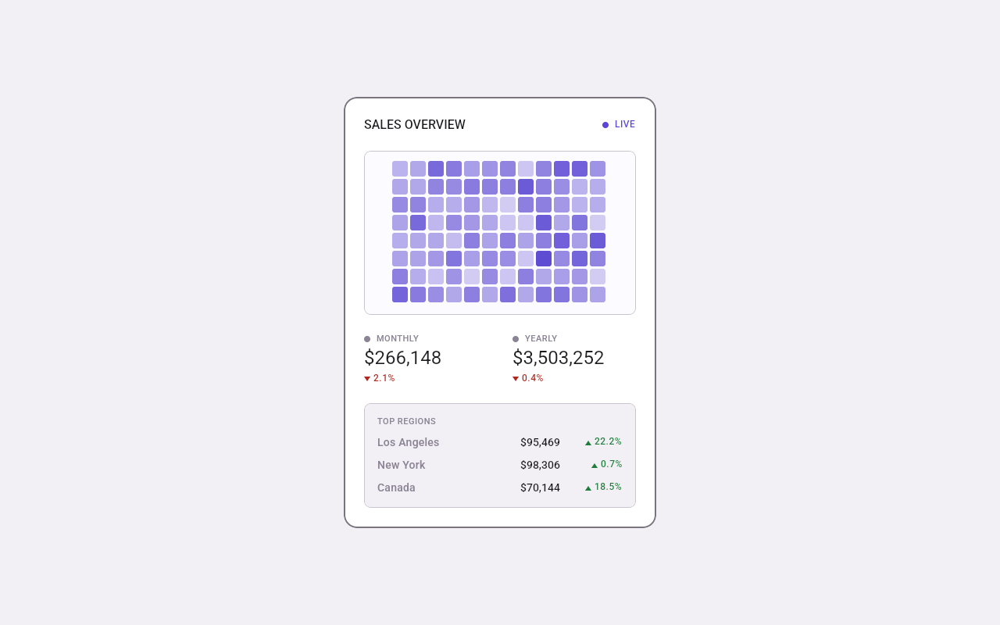

# Sales Heatmap

Sales Heatmap is a live sales overview widget for Uno Platform. An MVUX feed publishes a new sales snapshot every two
seconds, and the card shows it: an activity heatmap, the monthly and yearly totals, and the top three regions.



## What it shows

- **The card:** a 12 by 8 heatmap, monthly and yearly totals with their change, and the top regions (Los Angeles, New
  York, Canada), with a blinking LIVE indicator.
- **Easing:** the figures ease toward each new snapshot and the easing timer stops once they settle. A rise shows in the
  app's positive colour and a fall in the theme's Error colour, each with a drawn arrow.
- **The heatmap:** plain XAML rectangles in the theme's Primary colour; a cell's heat is its opacity, in 32 steps. Cells
  drift toward random targets, and a cell changes only when its step does.
- **The theme does the look:** every colour is a palette role or the one no-role colour in `App.xaml` (`PositiveColor`),
  text uses the Material type styles, and spacing and corners are Uno.Themes tokens. Change the palette (or edit it in
  Studio's Themes tab) and the whole card follows, in Light and Dark.
- **Phone fit:** the card lays out at 400 wide and scales down on a narrower screen.

The data is simulated in the model; nothing leaves the device.

## Built with

- Uno Platform single project, with Uno.Sdk pinned in `global.json`: desktop, WebAssembly and Android.
- **MVUX:** `MainModel` exposes `IFeed<SalesSnapshot>` from an async enumerable, and `MainPage` shows it in a
  `FeedView` with a loading state.
- **Navigation Extensions:** the shell and its default `Main` route, with the Toolkit's extended splash screen.
- **Material** through `MaterialToolkitTheme`, with the palette in `Styles/ColorPaletteOverride.json` (generated to
  `.xaml`, referenced from the theme's `Colors`), and the **Toolkit**.

## Try it

You need the .NET 10 SDK; the Uno.Sdk version comes from `global.json`. Restore the workloads for the heads you build
with `dotnet workload restore`.

```bash
# Desktop
dotnet run --project SalesHeatmap/SalesHeatmap.csproj -f net10.0-desktop

# WebAssembly
dotnet publish SalesHeatmap/SalesHeatmap.csproj -f net10.0-browserwasm -c Release -o publish
# then serve publish/wwwroot with any static file server
```

In Visual Studio, Rider or VS Code, open `SalesHeatmap.sln`.

## Layout

| Path | What is there |
|---|---|
| `SalesHeatmap/Presentation/MainModel.cs` | the snapshot feed |
| `SalesHeatmap/Presentation/SalesSnapshot.cs` | the snapshot record and its random next step |
| `SalesHeatmap/Presentation/MainPage.xaml` | the `FeedView` and the scaling card |
| `SalesHeatmap/Presentation/SalesHeatmapWidget.xaml(.cs)` | the widget: the card, the heatmap and the easing |
| `SalesHeatmap/Presentation/Shell.xaml`, `App.xaml.cs` | the shell, the host and the routes |
| `.studiolive/`, `uno-sample.json` | the Studio info files, icon and screenshots |
